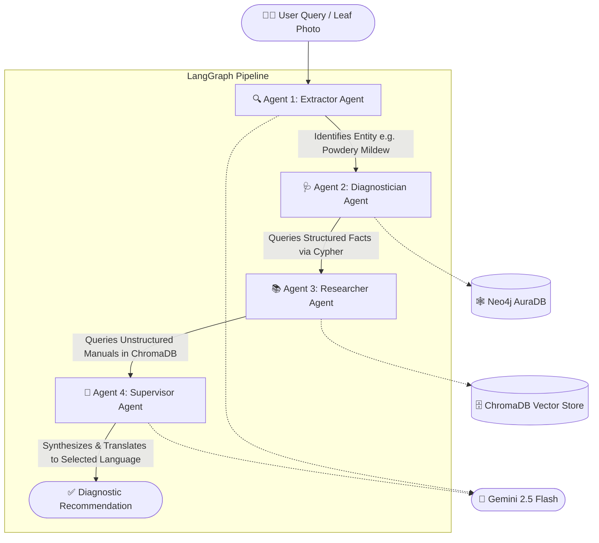
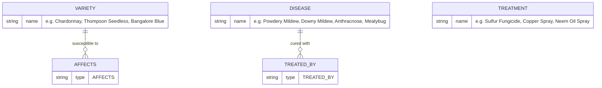
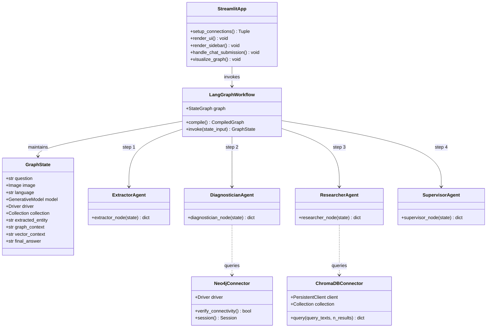
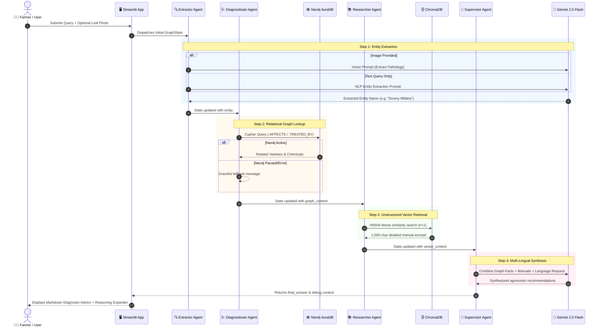

# 🍇 Grape-Mind AI — Advanced Hybrid Graph RAG & Multi-Agent Chatbot

<div align="center">


**A state-of-the-art Multi-Agent system for viticulture. Features a Hybrid Graph/Vector RAG pipeline governed by a LangGraph Supervisor, with dual support for Cloud APIs (Gemini) and Locally Fine-Tuned Open-Source Models (Llama-3 8B).**

</div>

---

## 🚀 Key Architectural Upgrades (V2.0)

This project has evolved beyond standard RAG into a highly advanced enterprise-grade AI architecture:

- 🧠 **Multi-Agent Orchestration (LangGraph):** The system no longer relies on a single LLM prompt. Queries are routed through a sequential stateful graph (`Extractor` → `Diagnostician` → `Researcher` → `Supervisor`), mimicking human diagnostic workflows.
- 🔬 **Custom Model Fine-Tuning (QLoRA):** Automated pipeline extracting ground truth relationships from Neo4j into instruction-tuning JSONL datasets to fine-tune **Meta Llama-3-8B** using 4-bit NormalFloat quantization, LoRA adapters, and Hugging Face `TRL`.
- 🔍 **Hybrid Retrieval:** Context is pulled both deterministically from structured knowledge (**Neo4j**) and semantically from unstructured manuals (**ChromaDB**).
- 🌐 **Cloud vs. Local Execution:** The live Streamlit app runs securely on Gemini for serverless efficiency, while natively supporting offline inference with fine-tuned Llama-3 weights.

---

## 🌟 Comprehensive Feature Catalog

| # | Feature Name | Component / File | Description |
|:---:|---|---|---|
| **1** | **Multi-Agent Orchestration** | `agents/workflow.py` | A 4-agent stateful graph (`Extractor` → `Diagnostician` → `Researcher` → `Supervisor`) separating concerns across entity extraction, graph lookups, document retrieval, and final synthesis. |
| **2** | **Hybrid Knowledge Retrieval** | `agents/workflow.py`, `hybrid_retriever.py` | Combines deterministic 1-to-2 hop graph traversal (Cypher) with dense semantic vector similarity retrieval (ChromaDB HNSW index). |
| **3** | **Interactive Graph Visualization** | `app.py` | Uses `streamlit-agraph` to render an interactive physics-directed network graph of varieties, diseases, and chemical treatments with custom node avatars. |
| **4** | **Computer Vision & Multimodal Diagnosis** | `app.py` | Accepts leaf and vine imagery via file upload or live camera feed, analyzing visual symptoms with Gemini Vision to extract plant pathologies. |
| **5** | **Multilingual Agricultural Synthesis** | `app.py`, `agents/workflow.py` | Synthesizes responses in 5 major Indian languages (**English, Hindi, Marathi, Kannada, Telugu**) to assist regional farmers. |
| **6** | **Unstructured Document Vectorization** | `ingest_data.py` | Ingests PDFs and domain text files, partitions them into 1,000-character chunks, and stores persistent embeddings into ChromaDB (`grape_docs`). |
| **7** | **Automated Knowledge Graph Ingestion** | `build_knowledge_base.py` | Fetches Wikipedia viticulture corpora, extracts relational triples via zero-shot LLM prompts, generates Cypher `MERGE` queries, and writes directly to Neo4j. |
| **8** | **Graph Seeding & Domain Expansion** | `populate_graph.py`, `expand_data.py` | Seeds commercial grape varieties (*Chardonnay, Cabernet Sauvignon, Thompson Seedless, Bangalore Blue, Shiraz, Merlot*) and treatments (*Sulfur, Copper Spray, Neem Oil, Mancozeb*). |
| **9** | **Automated Dataset Extraction Pipeline** | `dataset_prep.py` | Traverses graph entity relationships to compile formatted Question/Answer pairs into instruction-following JSONL datasets (`agri_dataset.jsonl`). |
| **10** | **4-Bit QLoRA Fine-Tuning Pipeline** | `fine_tune.py` | Full PyTorch, Hugging Face `transformers`, `peft`, and `trl` script utilizing BitsAndBytes 4-bit NormalFloat (NF4) quantization to fine-tune Llama-3-8B. |

---

## 🏗️ Multi-Agent Architecture



---

## 📊 Data Models & Schemas

### 1. Neo4j Property Graph Schema (Labeled Property Graph)

The Knowledge Graph is structured as a directed property graph modeling commercial viticulture taxonomy and pest management:



#### Graph Relational Query Pattern
- **1-to-2 Hop Traversal Query:**
  ```cypher
  MATCH (n {name: $name})-[:AFFECTS|TREATED_BY*1..2]-(related)
  RETURN DISTINCT related.name as info
  ```

---

### 2. ChromaDB Vector Store Schema

- **Collection Name:** `grape_docs`
- **Storage Backend:** Persistent SQLite metadata + HNSW binary indices
- **Document Chunk Size:** 1,000 characters
- **Record Structure:**
  - `id`: Unique identifier format: `{filename}_chunk_{index}` (e.g., `Downy_mildew.txt_chunk_0`)
  - `document`: Raw text manual content with pathology, symptoms, or application dosage
  - `metadata`: `{"source": "<filename>"}`
  - `embedding`: Dense semantic vector representation

---

### 3. LangGraph State Schema (`GraphState`)

Defined in `agents/workflow.py`:

```python
class GraphState(TypedDict):
    question: str                  # User's raw text prompt
    image: any                     # PIL.Image.Image instance (or None)
    language: str                  # Target language for final synthesis
    model: any                     # Google GenerativeAI model instance
    driver: any                    # Neo4j Driver instance
    collection: any                # ChromaDB Collection instance
    
    # Internal Agent Communication Channels
    extracted_entity: str          # Variety or disease extracted by Agent 1
    graph_context: str             # Relational facts fetched by Agent 2 from Neo4j
    vector_context: str            # Text manual excerpts fetched by Agent 3 from ChromaDB
    final_answer: str              # Polished final diagnostic answer from Agent 4
```

---

### 4. Fine-Tuning Instruction Dataset Schema (`agri_dataset.jsonl`)

The dataset generator `dataset_prep.py` formats graph ground-truth into standard Alpaca/Llama-style JSONL records:

```json
{
  "instruction": "What is the recommended treatment for Powdery Mildew?",
  "output": "The recommended chemical treatment for Powdery Mildew is Sulfur Fungicide."
}
```

```json
{
  "instruction": "Which disease commonly affects the Chardonnay grape variety?",
  "output": "The Chardonnay grape variety is highly susceptible to Powdery Mildew."
}
```

---

## 🧩 Class Diagrams & Component Architecture

### Component Class Diagram



---

### End-to-End Execution Sequence



---

## 🗂️ Project Structure & File Inventory

```
agrichatbot/
├── app.py                  # 🚀 Main Streamlit application (UI + LangGraph Execution)
├── requirements.txt        # 📦 Python production dependencies
├── .env                    # 🔑 API keys and DB credentials (git-ignored)
├── agri_dataset.jsonl      # 🗄️ Automated Q&A dataset generated from Neo4j
├── agents/
│   └── workflow.py         # 🧠 LangGraph StateGraph, Nodes, and Agent definitions
├── chroma_db/              # 🗄️ Persistent local ChromaDB vector store
├── data/                   # 📂 9 domain manuals & agricultural reference texts
│   ├── Black_rot_(grape_disease).txt
│   ├── Bordeaux_mixture.txt
│   ├── Botrytis_cinerea.txt
│   ├── Cabernet_Sauvignon.txt
│   ├── Chardonnay.txt
│   ├── Downy_mildew.txt
│   ├── Fungicide.txt
│   ├── Phylloxera.txt
│   └── Powdery_mildew.txt
├── build_knowledge_base.py # 🌐 Wikipedia crawler & automated Cypher injector
├── dataset_prep.py         # 🗄️ Automated script to extract Neo4j Graph into JSONL
├── expand_data.py          # 🌿 Bulk seeds commercial grape varieties & treatments
├── fine_tune.py            # 🔬 PyTorch/HuggingFace script for Llama-3 QLoRA fine-tuning
├── hybrid_retriever.py     # 🔍 Standalone CLI hybrid retrieval prototype
├── ingest_data.py          # 📥 PDF/TXT ingestion → chunking → ChromaDB storage
├── populate_graph.py       # 🌱 Seeds initial Neo4j viticulture facts
└── check_models.py         # 🧪 Utility to verify Gemini model access
```

---

## 🔬 Local Fine-Tuning Pipeline (Meta Llama-3 8B)

This project includes a fully functional pipeline to train an offline, open-source model using ground-truth facts extracted directly from the Neo4j Knowledge Graph:

1. **Dataset Generation:**
   ```bash
   python dataset_prep.py
   ```
   Traverses the Neo4j Graph (`Variety -> Disease -> Treatment`) and outputs formatted Question/Answer pairs into `agri_dataset.jsonl`.

2. **Model Training (Google Colab / Local GPU):**
   Run `fine_tune.py` on an Nvidia GPU (e.g., T4, RTX 3050+):
   - **Quantization:** 4-bit NormalFloat (`nf4`) via `BitsAndBytesConfig` with `float16` compute dtype.
   - **PEFT / LoRA Configuration:** Rank $r=16$, $\alpha=32$, dropout $0.05$.
   - **Trainer:** Hugging Face `trl.SFTTrainer` with `paged_adamw_32bit`.

3. **Offline Local Inference:**
   The trained LoRA adapter weights (`adapter_model.safetensors`) can be loaded locally with CPU offloading for edge diagnostics without requiring internet connectivity.

---

## ⚙️ Setup & Installation

### Prerequisites
- Python 3.10+
- A [Neo4j AuraDB](https://neo4j.com/cloud/platform/aura-graph-database/) account (free tier works)
- A [Google AI Studio](https://aistudio.google.com/) API key (Gemini)

### 1. Clone the Repository
```bash
git clone https://github.com/Abhi318-hash/grape-graph-rag.git
cd grape-graph-rag
```

### 2. Create a Virtual Environment
```bash
python -m venv venv

# Windows
venv\Scripts\activate

# macOS/Linux
source venv/bin/activate
```

### 3. Install Dependencies
```bash
pip install -r requirements.txt
```

*(Note: PyTorch, Transformers, and Accelerate are deliberately excluded from `requirements.txt` to keep the Streamlit deployment lightweight. They are only required for the optional `fine_tune.py` training pipeline).*

### 4. Configure Environment Variables
Create a `.env` file in the root directory:
```env
GOOGLE_API_KEY=your_google_gemini_api_key
NEO4J_URI=neo4j+ssc://your-instance.databases.neo4j.io
NEO4J_USERNAME=your_username
NEO4J_PASSWORD=your_password
NEO4J_DATABASE=your_database_name
```

### 5. Seed the Databases (Optional if fresh instance)
```bash
# Seed Knowledge Graph
python populate_graph.py
python expand_data.py

# Ingest textual manuals into ChromaDB
python ingest_data.py
```

### 6. Launch the Streamlit App
```bash
streamlit run app.py
```

---

## 🌍 Live Features Summary

- **💬 LangGraph Workflows** — Real-time sidebar execution status tracking active agents.
- **🕸️ Graph Visualizer** — Interactive Neo4j knowledge graph rendered with custom node styling.
- **📸 Visual Diagnosis** — Accepts leaf and cluster photos for multimodal pathology detection.
- **🌐 Multi-Language** — Synthesizes answers in English, Hindi, Marathi, Kannada, or Telugu.
- **📱 Responsive UI** — Built for mobile fieldwork and field tablet exploration.

---

<div align="center">

Made with ❤️ for Indian Grape Farmers | Engineered for Advanced AI Portfolios

</div>
